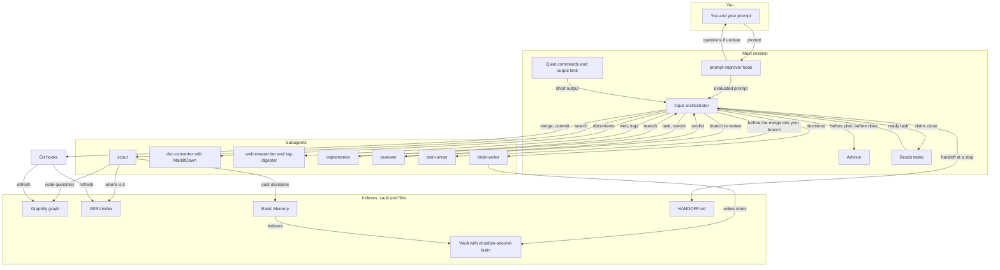

# lean-harness

A step-by-step runbook that Claude Code follows to set up your Claude Code environment once, for all your projects: user-level config in `~/.claude/`, low-cost subagents (agents with their own context window that the main session starts), memory layers and token-saving CLI tools.

Long Claude Code sessions get expensive because every request sends the full context again: the *permanent context* that loads before your first message (instruction files, auto memory, skill descriptions, the output of start-up hooks and, by default, the tool names and instructions of MCP servers, which give Claude extra tools), plus every earlier message and tool result. Prompt caching bills the repeated part at a lower price, but it is read again on every request, so a larger context costs more on each turn. A model change, added or removed tools, or an expired cache rebuilds the cache at a higher price. `lean-harness` walks Claude through 16 methods in 6 classes. Seven shrink what loads or what Claude reads in. The other nine delegate work, plan and split sessions, and keep project memory outside the context.

## What it sets up

| Class | What changes |
| --- | --- |
| A. Permanent context | Short `~/.claude/CLAUDE.md`, fewer MCP servers, quiet skill descriptions |
| B. Input compression | Smaller shell output, tool results and documents |
| C. Navigation | Search and maps instead of full-file reads |
| D. Delegation | Opus orchestrator with an advisor (a second model that Claude asks before it completes a plan and before it says a task is done), low-cost subagents in `~/.claude/agents/` that write large results to files |
| E. Process | One task per session, clean handoffs, clear prompts, a local task tracker |
| F. Memory | Project knowledge and its search |

The method list of each class is in `references/ontology.md`.

## Tools

Each tool sits in one class and acts at a known moment. Detail and install commands: the section in `references/` and `SETUP.md`.

| Tool | Class, section | Role | When it acts |
| --- | --- | --- | --- |
| [Short `CLAUDE.md`, MCP trim](references/a-permanent-context.md) | [A1, A2](references/a-permanent-context.md) | keeps the permanent context small | every session start |
| [`scripts/md_budget.py`](scripts/md_budget.py) | [A1](references/a-permanent-context.md) | checks the line limits of the always-loaded `CLAUDE.md` files (read only) | phase 1 and Part 2 verify; you run it for maintenance |
| [Quiet commands](references/b-input-compression.md) | [B1](references/b-input-compression.md) | build, test and lint commands in their quiet forms, written in the project `CLAUDE.md`; no hook | each shell command |
| [Output limit of Claude Code](references/b-input-compression.md) | [B2](references/b-input-compression.md) | built in: a successful Bash result over about 30,000 characters goes to a file, and Claude gets its path and a preview; a failed command shows a head and tail excerpt of about 10,000 characters | large Bash results |
| [MarkItDown](https://github.com/microsoft/markitdown) | [B3](references/b-input-compression.md) | converts PDF and Office files to Markdown | `doc-converter`, before a document is read |
| [Graphify](https://pypi.org/project/graphifyy/) | [C1](references/c-navigation.md) | map of relations (`GRAPH_REPORT.md`, `graphify query`) | `scout`, architecture questions; git hooks rebuild the code graph when a commit changes code or Markdown |
| [XERJ](https://github.com/xerj-org/xerj) | [C2](references/c-navigation.md) | passage search (`xerj search`, `xerj def`) | `scout`, where is it written; git hooks refresh the index while the node runs |
| [Opus orchestrator, advisor](references/d-delegation.md) | [D1](references/d-delegation.md) | plans, delegates, asks a second model | before a plan is complete and before "done" |
| [Subagents](references/d-delegation.md) | [D2 to D4](references/d-delegation.md) | `scout`, `doc-converter`, `log-digester`, `test-runner`, `brain-writer`, `web-researcher`, `implementer`, `reviewer` | each task; results over 30 lines go to `.agent-out/` |
| [ponytail](https://github.com/DietrichGebert/ponytail) | [D2](references/d-delegation.md) | rules for the smallest complete change; skill only, not the plugin; preloaded into `implementer`; pinned to v5.3.3 | each start of `implementer` |
| [Beads](https://github.com/steveyegge/beads) | [E2](references/e-process.md) | local task tracker | session start, `bd ready` to `bd close` |
| [handoff](https://github.com/odinokov/handoff) | [E3](references/e-process.md) | `/handoff` writes `HANDOFF.md` | before you stop unfinished work |
| [prompt-improver](https://github.com/severity1/claude-code-prompt-improver) | [E4](references/e-process.md) | asks questions when a prompt is unclear | each prompt |
| [obsidian-second-brain](https://github.com/eugeniughelbur/obsidian-second-brain) | [F1](references/f-memory.md) | vault of notes: facts, decisions, rejected options, contracts | `brain-writer` writes the notes |
| [Basic Memory](https://github.com/basicmachines-co/basic-memory) | [F3](references/f-memory.md) | local search over the notes of `Projects/<project>/`, not the code (MCP server `basic-memory`, tool `bm_search`); read only for Claude, `brain-writer` stays the only writer | `scout`, for past decisions |
| [Claude Code auto memory](references/f-memory.md) | [F2](references/f-memory.md) | keeps preferences and feedback; keeps decisions only when the project has no vault folder | automatically |

You can refuse any tool. Claude skips it and records the refusal. A tool you already have is checked and configured, not installed again.

## Requirements

- Claude Code CLI 2.1.331 or later
- Linux, with git, uv, python3 and curl
- Optional: Node.js or Homebrew (only Beads uses them; one of the two is enough)
- Optional: access to the Fable model, for the advisor

## Get the guide

Clone it once, outside your projects. It is not a skill or a plugin: do not put it in `~/.claude/skills/`.

```bash
git clone https://github.com/odinokov/lean-harness ~/tools/lean-harness
```

You get the folder `~/tools/lean-harness`.

## Set up your environment

Run four short sessions from the guide directory. Each one does one phase. Phases 1 to 3 end with a restart of Claude Code.

```bash
cd ~/tools/lean-harness
claude
```

```text
Read SETUP.md and do the next phase.
```

| Phase | What happens |
| --- | --- |
| 1 | Checks prerequisites, takes an inventory of what you already have, trims MCP servers and plugins, writes `~/.claude/CLAUDE.md`, sets Opus with the Fable advisor, creates six subagents (scout, log-digester, test-runner, web-researcher, implementer, reviewer), adds `.agent-out/`, `HANDOFF.md` and `.beads/` to your global gitignore. No installs. If a hook or plugin changes Bash commands or output (for example RTK or Context Mode), Claude tells you that this guide does not use such a tool (`references/b-input-compression.md`) and asks before it changes anything. |
| 2 | handoff, the ponytail skill for `implementer`, Beads, prompt-improver, the shell-output rule in `~/.claude/CLAUDE.md` (quiet commands, B1) and a check of the output limit (B2; not applicable while a plugin or hook that changes Bash output is enabled), MarkItDown (with the `doc-converter` subagent), Graphify, XERJ |
| 3 | second-brain vault: obsidian-second-brain, the `brain-writer` subagent and Basic Memory (search) |
| 4 | Checks everything and reports what is installed, refused or broken. No installs. |

After phases 1 to 3, run the built-in commands Claude names (for example `/model opus`), quit, open a new terminal, start a new conversation with `claude` (not `claude -c`) in the same directory, and send the same prompt. Claude continues from `~/.claude/lean-harness/setup-log.md`.

Phase 4 ends with a report of the status of each tool and how to start project onboarding.

## Onboard a project

After phase 1, prepare each project in one session from its root:

```bash
cd <your-project>
claude
```

```text
Read ~/tools/lean-harness/SETUP.md and onboard this project.
```

Effort is a suggestion, not a guide rule: start the session with `claude --effort high` (Claude Code 2.1.331 has the flag). Two steps need judgment: the trim of the project `CLAUDE.md` and the blocks that Graphify and XERJ add to git hooks the project already has. Use `--effort medium` when the project has no `CLAUDE.md`, or a short one, and no git hooks of its own. The model and the advisor stay as phase 1 set them.

Claude commits the current state, copies each file that it changes and that the commit does not hold to a backup folder, trims the project `CLAUDE.md` to its commands and invariants, with the build, test and lint commands in their quiet forms (B1), and sets up the per-project parts of the installed tools: the Beads tracker, the Graphify graph and the XERJ index (git hooks refresh both at each commit) and the vault folder with its Basic Memory project (`<project>-brain`; a note written in the same session needs `bm project index "<project>-brain"`). It skips the tools you did not install. The first commit that changes code or Markdown builds the code graph; the LLM pass (`/graphify .`) takes its own session, and Claude tells you when. The session ends like a phase: Claude lists the built-in commands to run and the next prompt.

After phase 1, to check the environment, or an onboarded project, send `Read ~/tools/lean-harness/SETUP.md and do the check.`

## Use the harness

The diagram shows how the tools work together in a normal session. The numbered steps below explain it.



The diagram does not show the parts that act outside the task flow: the short `CLAUDE.md` files with the MCP trim, `scripts/md_budget.py` and Claude Code auto memory.

Start each task in a new session from the project root. One task, or one group of independent tasks, belongs in one session. In a project with Beads, run `bd ready` and name the task id.

The main session is an orchestrator:

| You ask for | Who does it |
| --- | --- |
| Code, architecture or docs questions | scout (Graphify, XERJ) |
| Tests | test-runner |
| Logs and CI output | log-digester |
| Web | web-researcher (WebSearch and WebFetch) |
| PDF and Office files | doc-converter |
| Code changes | implementer in a git worktree, then reviewer and test-runner; Claude merges the worktree branch into your branch only on your instruction, and never pushes without one |
| README | implementer (audit, your approval, then apply) |
| Past decisions | scout (Basic Memory search) |
| Decisions and facts | brain-writer, into the vault folder of the project |

A normal session after setup (plan sessions: `references/e-process.md`, E1; Claude asks the advisor before a plan is complete):

1. **Start.** Claude loads the `CLAUDE.md` files. The Beads start text (`.beads/PRIME.md`) and the vault hook add a few lines. If the session uses XERJ, Claude starts the XERJ node (it does not start by itself; `references/c-navigation.md`, C2).
2. **Task.** You name the task from `bd ready`. Claude claims it: `bd update <id> --claim`.
3. **Prompt.** prompt-improver evaluates each prompt, and also each notification of a finished background subagent. An unclear prompt gets up to six questions. A prompt that starts with `*` skips it.
4. **Search and read.** `scout` starts from `GRAPH_REPORT.md`, then `graphify query`, `xerj search` and `xerj def`, and uses grep when there is no graph or index. Claude gives `scout` the XERJ prefix of the project (it is in the project `CLAUDE.md`), and `scout` uses `xerj` only with that prefix. For past decisions it searches Basic Memory (`bm_search`); the status filter skips superseded notes, and it reads the note with Read. If the search fails, it greps the vault folder of the project. Documents go to `doc-converter` first.
5. **Compression.** Commands run in the quiet forms of the project `CLAUDE.md`. Claude Code saves a large successful Bash result (over about 30,000 characters) to a file and gives Claude its path and a preview. A failed command shows an excerpt of about 10,000 characters, with no file. A subagent writes a result over 30 lines to `.agent-out/<task-id>/` (in the global gitignore) and replies in at most 10 lines with a path.
6. **Code.** `implementer` works in a worktree with the preloaded ponytail skill, for the smallest complete change. `reviewer` checks the diff; on "changes required", `implementer` runs again and `reviewer` checks again. Then Claude merges your branch into the worktree branch, and `test-runner` runs the verification command there; a failure goes back to `implementer` and to the review. Claude merges the worktree branch into your branch only on your instruction; if you gave none, it asks. Claude asks the advisor before it says that the task is done and runs `bd close <id>`. Only the orchestrator changes Beads.
7. **Decisions.** Claude sends each decision, rejected option, fact and contract to `brain-writer`, which writes it to `Projects/<project>/` in the vault; Basic Memory then indexes the note (`references/f-memory.md`, F1 to F3).
8. **Index refresh.** Git hooks of Graphify and XERJ rebuild the graph and the index in the background after commit, merge, checkout and rewrite. They skip linked worktrees. The Graphify rebuild runs only when the commit changes code or Markdown; the XERJ refresh needs the running node.
9. **Stop.** Complete: `/clear`. Not complete: `/handoff` (writes `HANDOFF.md`), then `/clear` or a new session; start it from `HANDOFF.md`, not with `claude -c`. To stay in the session, run `/compact <what to keep>`. Details: `references/e-process.md`, E3.

- Run keys and logins in your own terminal.
- Maintenance: `Read ~/tools/lean-harness/SETUP.md and do the check.`, `python3 ~/tools/lean-harness/scripts/md_budget.py --project .`, and backups in `~/.claude/lean-harness/backup/`.

Example prompts:

```text
Where is the config file parsed?
Do task <id> from `bd ready` and add a test.
Audit the README for new users.
Record the decision: we keep Python 3.10.
```

## What to expect

- **You run the built-in commands.** Claude cannot type `/context`, `/memory`, `/mcp`, `/model`, `/advisor`, `/plugin`, `/hooks`, `/usage`, `/clear` or `/compact`. It can start skills such as `/handoff` and `/graphify`. It asks you to run them and to paste the result.
- **You approve each phase.** Claude shows the tools, the exact commands and the files that change, then waits. Some actions need their own approval: rule 7 of `SETUP.md` lists them.
- **Claude copies files before it changes them, or records how to undo the change.** Before each phase, Claude copies each of these items that exists: `~/.claude/settings.json`, `~/.claude/CLAUDE.md`, `~/.claude/agents/`, `~/.claude/rules/`, the global git ignore file (`git config --global core.excludesFile`; if it is empty, `~/.config/git/ignore`) and each skill folder that the phase changes to `~/.claude/lean-harness/backup/<date>-phase<N>/`. `~/.claude.json` has no copy, and the setup log holds the command that undoes each MCP server change. Before it onboards a project, Claude commits the current state. Before it changes a file that the commit does not hold (a gitignored or untracked file, the git hooks, `.git/config` or `.git/info/exclude`), it copies that file to `~/.claude/lean-harness/backup/<date>-part2-<project>/`. Three parts of the onboarding have an undo command: the blocks that Graphify and XERJ add to the git hooks (`references/c-navigation.md`, C1 and C2), the XERJ index (C2) and the memory project (`references/f-memory.md`, F3). The XERJ index, the memory project, the notes in the vault and the Basic Memory database have no copy. The backup folder can hold keys, so keep it private on your machine.
- **Some tools send data out.** Beads sends usage metrics (command names and a machine ID) until you turn them off (`bd metrics off`). You enter each key in your own terminal.
- **Basic Memory adds an MCP server to every session.** The weight is about 480 tokens of instructions, and up to about 8,200 tokens of tool schemas if all of them load. Claude asks you to run `/context` and records the real number. Restart Claude Code after phase 3 so that the server connects.
- **It changes how Claude works in every project.** `~/.claude/CLAUDE.md` makes the main session an orchestrator that hands search, tests and code changes to subagents.
- **Use it interactively.** Do not run it with `claude -p`. The setup needs you for built-in commands, for separate approvals, and for logins and keys in your own terminal.

The guide files add nothing to your permanent context: no guide file loads at session start, and Claude reads them only in a setup or maintenance session that you start with the guide prompt. The tools they install do add to it: the second-brain plugin (version 0.20.0: 49 commands and about 2,000 tokens, an estimate), the `basic-memory` server (about 480 tokens of instructions), the descriptions of the skills the guide installs (handoff, graphify, ponytail and the others in `references/a-permanent-context.md`), the short `~/.claude/CLAUDE.md`, and the start text of Beads and the vault. prompt-improver adds a skill description to it and hook text to each prompt.

## Layout

The section "File map" in `SETUP.md` shows which file holds what.

## Status

These tools change often, so Claude re-reads each README before it installs anything. The dates of the tests are in `references/sources.md`.

Two tools have licenses worth reading before commercial use. XERJ: the engine is Apache-2.0, and the release binaries since rc.101 include proprietary Query-1 crates. Basic Memory: AGPL-3.0-or-later. See `references/overlaps.md`.

## License

MIT. See [LICENSE](LICENSE).
